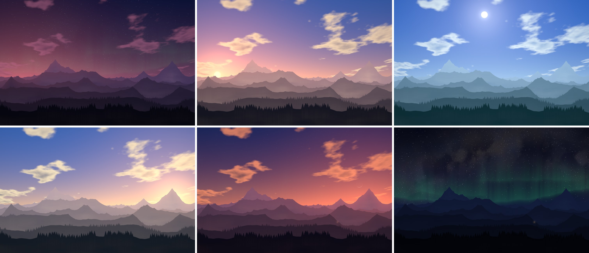
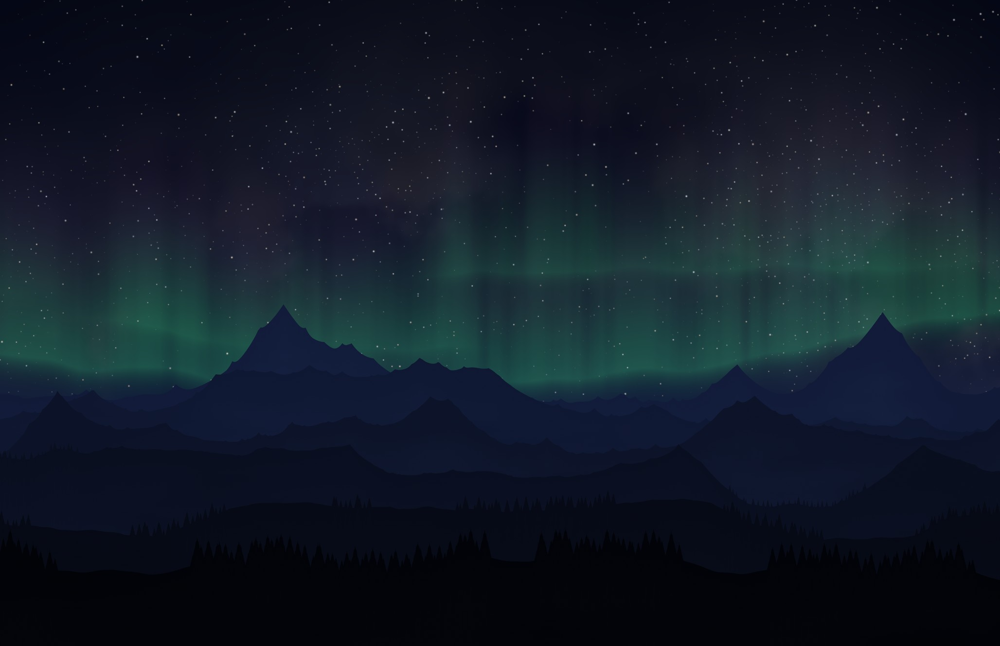
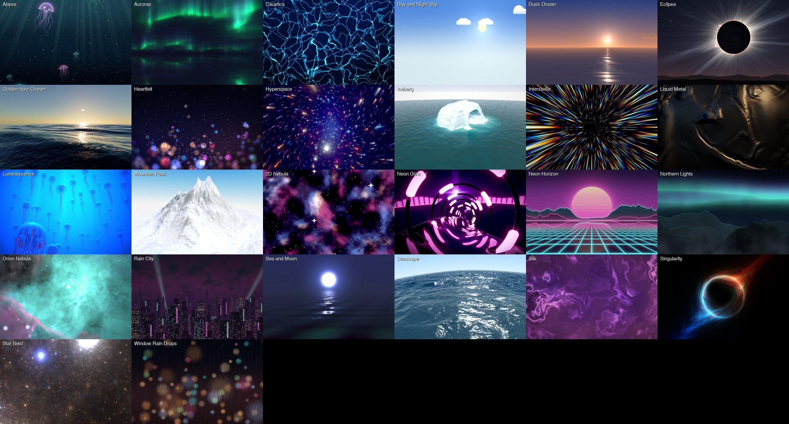

# MacOS Live Wallpaper

A live wallpaper for the Mac that follows your real sky, and costs almost nothing to run.

The default scene, Horizon, is a range of mountains under a sky that tracks the actual sun and moon for where you are: pink before sunrise, blue at noon, gold in the late afternoon, and at night stars, the Milky Way, aurora and the moon in tonight's real phase.

It also carries a library of 26 scenes by other authors, ported from open collections: oceans, auroras, an eclipse, jellyfish, nebulae, rain on glass, neon cities and more.





## Horizon

- **The sun** rises on one side of the picture, crosses the sky and sets on the other, at the right times for your location and the date.
- **The moon** shows its real phase, rises and sets on schedule, and its lit edge points at the sun.
- **Stars** twinkle and turn through the night together with the Milky Way. Shooting stars cross about once a minute, and one greets you shortly after you wake the Mac at night.
- **Aurora** curtains come and go at night.
- **Weather** changes from day to day: each day has its own cloud cover, and morning mist is thicker than evening mist.
- **A cabin window** lights up at dusk and goes out late in the evening.
- **The ridges lean** slightly toward your pointer while the desktop is in front.

## The scene library



*A frame from each scene. Every frame is under its scene's licence; the Auroras, Heartfelt, Luminescence, Mountain Peak and Seascape frames are CC BY-NC-SA 3.0.*

Every one of these was written by someone else and published under a licence that allows it to be shared. Each has been ported to Metal, credited, and tuned so that it stays within this app's energy budget. They are grouped in the menu as Nature, Stylised, Abstract, Cosy and Sci-Fi; the menu shows each scene's author and licence and links to the original.

[THIRD_PARTY_NOTICES.md](THIRD_PARTY_NOTICES.md) lists them all. Five may not be used commercially; see [Licences](#licences).

You can also use any video file of yours on a loop, or add a shader of your own: a scene is just a folder, described in [docs/SHADERS.md](docs/SHADERS.md).

## Requirements

- macOS 14 (Sonoma) or later
- A Mac with a Metal-capable GPU
- To build: Xcode or the Xcode Command Line Tools (`xcode-select --install`)

It has been developed and tested on one machine: an Apple Silicon MacBook Pro running macOS 27, on its built-in Retina display and with an external 4K monitor attached. CI builds and unit-tests it on GitHub's macOS 15 and latest runners; macOS 14 is the declared minimum but has not been run. Intel Macs and desktop widgets are expected to work but have not been tried; see [Known limits](#known-limits), and please [open an issue](../../issues) if something is off on yours.

## Install

There is no pre-built download yet, so you build it yourself. It takes about a minute.

```bash
git clone https://github.com/yxshee/MacOS-Live-Wallpaper.git
cd MacOS-Live-Wallpaper
./scripts/build-app.sh --install
```

That builds `build/LiveWallpaper.app`, copies it to `~/Applications` and starts it. Without `--install` it only builds, writing into `./build` and SwiftPM's `./.build`.

A mountain icon appears in the menu bar. There is no Dock icon and no window: the wallpaper is drawn behind your desktop icons.

## Using it

Everything is in the mountain icon's menu.

| Menu item | What it does |
|---|---|
| Horizon, Nebula | The two built-in scenes. |
| Nature, Stylised, Abstract, Cosy, Sci-Fi | The imported scenes, by style. Hover over one for its author and licence. |
| Video… | Asks for a video file and loops it, muted. |
| Open the Original… | Shown for an imported scene: opens its author's page. |
| Sky | Follow the real sky, or hold it at dawn, day, golden hour, dusk or night. Time-lapse runs a whole day in a minute. |
| Location… | Enter your latitude and longitude. See below. |
| New Landscape | Generate a different mountain range. |
| Lean Toward Pointer | Turn the pointer effect on or off. |
| Pause | Freeze the picture. |
| Launch at Login | Start with your Mac. macOS may ask you to approve it in System Settings. |

The first line of the menu says what the wallpaper is doing, for example "Running at 10 frames a second". Sky, Location…, New Landscape and Lean Toward Pointer appear only while the Horizon scene is chosen.

### Location

By default the app does not know where you are. It takes the reference city of your Mac's time zone from the system's own time-zone table, which needs no permission and sends nothing anywhere. If you live far from that city, sunrise and sunset can be off by up to an hour or so. A time zone with no city (plain GMT, for example) falls back to a guess at 30°N; the Location… dialog always says which source is in use.

For times that are right to within a few minutes, choose **Location…** and enter your coordinates in decimal degrees (south and west are negative). You can find them by right-clicking a spot in most map apps.

## What it costs to run

The design goal is that you can leave it on all day on battery.

- **Nothing when hidden.** If every part of the desktop is covered (a full-screen app, say), the display is asleep, or another user is logged in, it stops drawing completely.
- **Only as many frames as the picture needs.** One frame a second when nothing but the sun is moving (a clear day); up to ten while you work in another app; up to twenty when the desktop is in front (that is, Finder is the active app); thirty while the ridges are following the pointer, and up to sixty only for the second a shooting star takes. On battery the rates drop. In Low Power Mode, or when the Mac is running hot, it draws at most five frames a second at lower resolution, stops the pointer lean and shooting stars, and pauses a video wallpaper.
- **Little work per frame.** The soft parts of the sky are painted at a quarter of the sky's resolution. The sharp mountain layer is separate and is redrawn only when the light has changed, a few times a minute. Clouds, aurora and mist take their noise from one small texture baked at launch.

Measured for Horizon on an M5 Pro MacBook Pro at 4112×2658:

| | |
|---|---|
| GPU work per frame | 0.04 to 0.13 ms, depending on the sky |
| GPU work per mountain redraw | 0.18 ms, about six times a minute |
| CPU while drawing 10 frames a second | about 0.6% of one core |
| CPU while hidden | 0% |
| Memory | about 190 MB, most of it the fixed cost of a Metal app plus the Retina mountain layer |

You can reproduce the GPU figures with `--bench`; see [CONTRIBUTING.md](CONTRIBUTING.md).

The imported scenes were not written with energy in mind, so each is held to a rule instead: its GPU time per frame multiplied by its frame-rate cap must come to 20 ms a second or less on the same machine, which most meet by being drawn at half resolution or lower and at 10 to 15 frames a second. They cost more than Horizon (2 to 20 ms of GPU a second, against about 1 to 2), pause the same way when hidden, and are slowed further on battery. If one still runs heavy on your Mac, the app lowers its resolution and then its frame rate by itself.

## Known limits

- **Accuracy.** The sun's position is good to a small fraction of a degree. The moon's phase is good to about half a degree; its position can be off by up to about a degree near the horizon, because refraction and the moon's parallax are ignored. Rise and set times can therefore be a few minutes off even with exact coordinates.
- **The view is a picture, not a planetarium.** The sun and moon are placed by their real direction and height; the star field and Milky Way are invented and only turn at the real rate. The aurora appears at every latitude.
- **Not a signed app.** A copy you build yourself runs without fuss. A copy built on another Mac and sent to you will be blocked by Gatekeeper until you allow it, which is why there are no downloads here yet.
- **Untested set-ups.** Intel Macs, three or more displays, desktop widgets, Stage Manager and "Click wallpaper to reveal desktop" have not been tried.
- **Imported scenes do not follow your sky.** Only Horizon and Day and Night Sky track the real sun; the rest are fixed pictures in motion.
- **Time-lapse is the one expensive mode.** It redraws everything thirty times a second, so it switches itself off when the app restarts.

## Uninstall

Choose **Quit Live Wallpaper** from the menu, then:

```bash
rm -rf ~/Applications/LiveWallpaper.app
defaults delete io.github.yxshee.LiveWallpaper
```

If you turned on Launch at Login, turn it off first, or remove the entry in System Settings › General › Login Items.

## Contributing

Bug reports, new scenes and reports from hardware that has not been tried are all welcome. [CONTRIBUTING.md](CONTRIBUTING.md) explains how the code is laid out, how to run the tests, and how to render frames without touching your desktop.

## Licences

The app's own code, which is everything outside `Scenes/`, is under the [MIT licence](LICENSE). That licence does not cover the scenes.

The imported scenes keep their authors' licences: MIT, CC0, or Creative Commons Attribution-NonCommercial-ShareAlike. Each scene's folder under `Scenes/` holds its licence, its credit and a note of what was changed in porting it (and, where a scene uses a small helper function by someone else, that person's notice too), and [THIRD_PARTY_NOTICES.md](THIRD_PARTY_NOTICES.md) lists them together.

Five scenes (Auroras, Heartfelt, Luminescence, Mountain Peak and Seascape) are non-commercial: free to use, share and adapt with credit, but not for commercial purposes, and anything adapted from them must carry the same licence. This app is free, carries no advertising and takes no payment, and on that footing it includes them. If that ever changes, or if you reuse this project in anything commercial, build with `./scripts/build-app.sh --permissive-only`, which leaves them out; [Scenes/NONCOMMERCIAL.md](Scenes/NONCOMMERCIAL.md) has the details.
